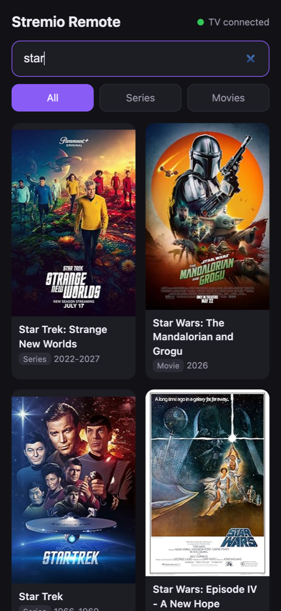

# Stremio Remote

Search for a series or movie on your phone or laptop and open it in Stremio on your Fire TV with one tap.

<p align="center"></p>

Typing titles with a TV remote is slow. Stremio Remote is a small web page you run on a home server: you search from your phone or laptop, tap a result, and the TV jumps straight to that title's page in Stremio, where you pick the season and episode.

## Features

- Search as you type, with posters, year and a Series or Movie label
- Filter results: All / Series / Movies
- One tap opens the title's page in Stremio on the TV, and wakes the screen from standby
- Status dot showing whether the TV is reachable
- Made for phones: no app to install, and it can be added to your home screen
- No accounts or API keys: search uses Stremio's own catalog (Cinemeta)

## How it works

```
phone / laptop ──HTTP──▶ Stremio Remote (Docker) ──ADB over Wi-Fi──▶ Fire TV
                               │
                               └──▶ Cinemeta (search)
```

The server searches [Cinemeta](https://v3-cinemeta.strem.io), Stremio's catalog. When you tap a result, it sends a Stremio deep link to the TV over ADB:

```
adb shell am start -a android.intent.action.VIEW -d "stremio:///detail/series/tt0903747"
```

## Requirements

- A Fire TV (or Android TV) with the **Stremio** app installed
- ADB debugging enabled on the TV
- A machine on the same network that runs Docker (home server, NAS, Raspberry Pi…)

### Enable ADB on a Fire TV

1. **Settings → My Fire TV → About**: select the device name 7 times to unlock Developer Options.
2. **Settings → My Fire TV → Developer Options**: turn on **ADB debugging**.
3. Find the TV's IP address under **Settings → My Fire TV → About → Network**. Give it a fixed address (DHCP reservation) in your router so it doesn't change.

## Deploy

### Docker Compose (recommended)

```yaml
services:
  stremio-remote:
    image: ghcr.io/kh3dr0n/stremio-remote:latest
    container_name: stremio-remote
    restart: unless-stopped
    ports:
      - "8080:8080"
    environment:
      - FIRETV_HOST=192.168.1.50:5555   # your TV's IP
    volumes:
      - adb-keys:/root/.android

volumes:
  adb-keys:
```

```sh
docker compose up -d
```

### Docker run

```sh
docker run -d --name stremio-remote --restart unless-stopped \
  -p 8080:8080 \
  -e FIRETV_HOST=192.168.1.50:5555 \
  -v stremio-remote-adb:/root/.android \
  ghcr.io/kh3dr0n/stremio-remote:latest
```

### Build from source

```sh
git clone https://github.com/kh3dr0n/stremio-remote.git
cd stremio-remote
# edit FIRETV_HOST in docker-compose.yml, and replace `image:` with `build: .`
docker compose up -d --build
```

Images are published for `linux/amd64`, `linux/arm64` and `linux/arm/v7`.

### First connection

The first time the container connects, the TV shows **"Allow USB debugging?"**. Tick **Always allow from this computer** and press **OK**. The page's status shows a yellow dot and "Accept ADB prompt on TV" until you do.

The ADB key is stored in the `adb-keys` volume, so you only approve it once. If you delete the volume, the TV will ask again.

## Use

1. Open `http://<server-ip>:8080` on your phone or laptop.
2. Type a title. Results appear as you type.
3. Use **All / Series / Movies** to narrow the results.
4. Tap a result. The TV opens it in Stremio, and the page confirms with "Opened on TV".

To use it like an app on your phone, add it to your home screen: **Share → Add to Home Screen** in Safari, or **⋮ → Add to Home screen** in Chrome.

### Status dot

| Dot | Meaning |
|---|---|
| Green: TV connected | Ready |
| Yellow: Accept ADB prompt on TV | Approve the prompt on the TV (see [First connection](#first-connection)) |
| Red: TV offline | TV is off or in deep sleep, ADB is disabled, or `FIRETV_HOST` is wrong |

## Configuration

| Variable | Required | Description |
|---|---|---|
| `FIRETV_HOST` | yes | The TV's address, `IP` or `IP:port` (port defaults to `5555`) |

## API

| Method | Path | Description |
|---|---|---|
| `GET` | `/api/search?q=<title>` | Search series and movies |
| `POST` | `/api/open` | Body `{"id": "tt0903747", "type": "series"}`, where `type` is `series` or `movie` |
| `GET` | `/api/status` | `{"connected": true, "state": "device", "host": "…"}` |

You can use `/api/open` from Home Assistant, Shortcuts or scripts:

```sh
curl -X POST http://<server-ip>:8080/api/open \
  -H 'Content-Type: application/json' \
  -d '{"id": "tt0903747", "type": "series"}'
```

## Troubleshooting

- **Red dot even though the TV is on:** check that ADB debugging is still on, and test from another machine with `adb connect <tv-ip>:5555`. Fire TV may turn ADB off after some system updates.
- **Prompt never appears on the TV:** the TV has to be awake to show it. Turn it on and reload the page.
- **"Opened on TV", but nothing happens:** make sure the Stremio app is installed. It is the Android TV build, package `com.stremio.one`.

## Security

The page has no login and can control your TV, so keep it on your home network. If you want remote access, put it behind a VPN (WireGuard, Tailscale) or a reverse proxy with authentication. Don't expose port 8080 to the internet.

## License

[MIT](LICENSE)
